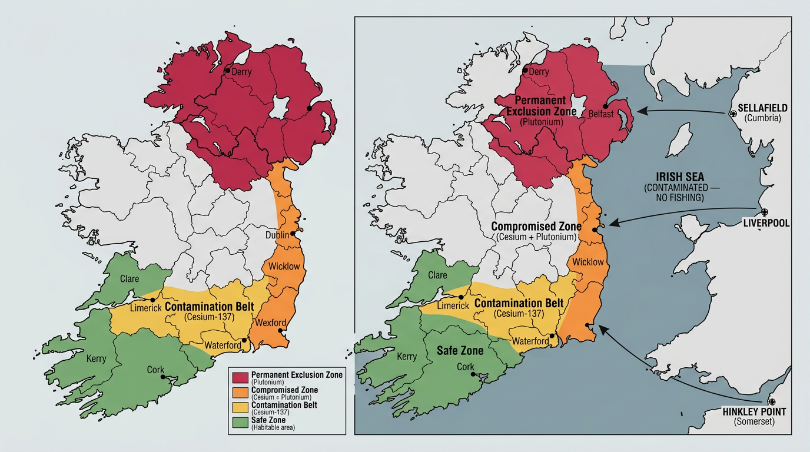
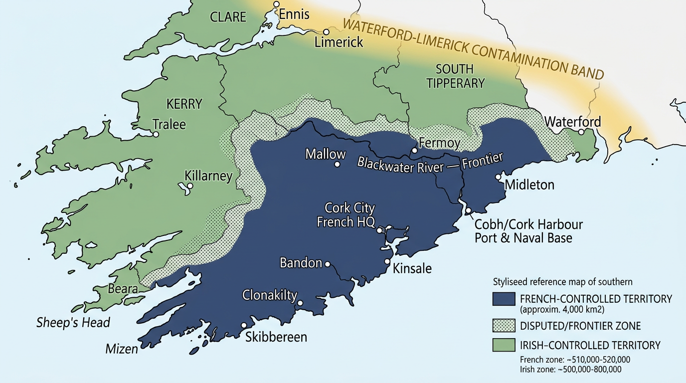
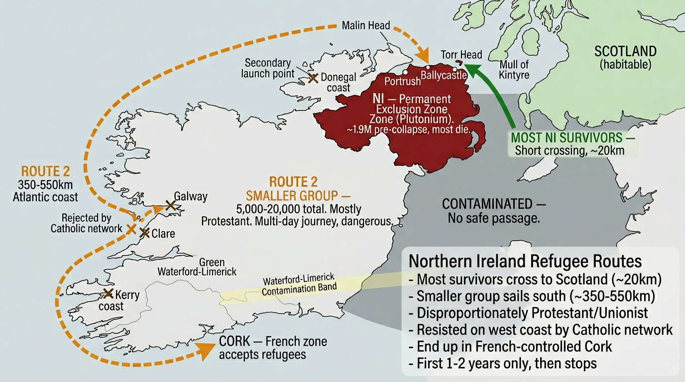
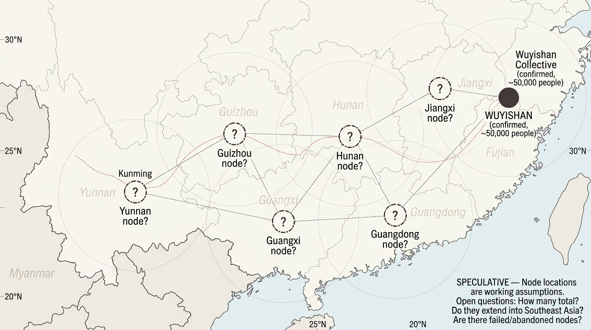
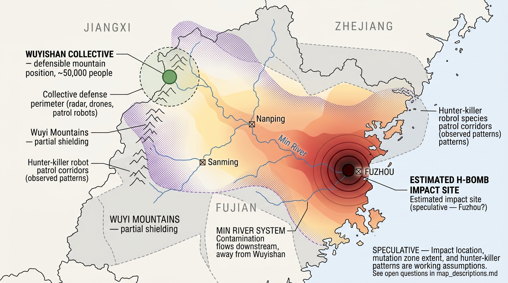
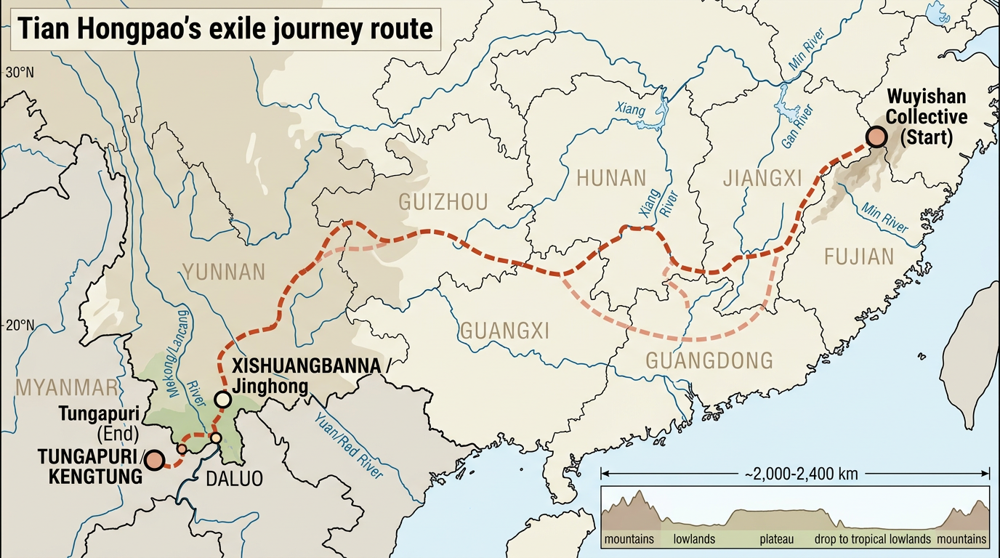
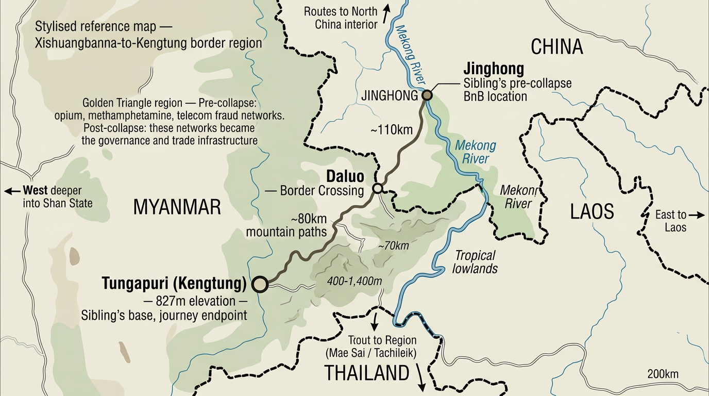
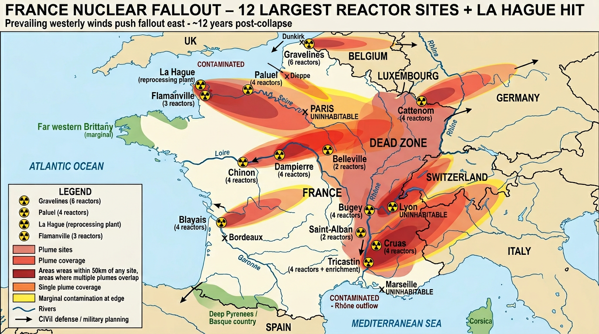

# Labile Advection

A multi-POV speculative novel set twelve years after a compounding global collapse — three intertwined strands following an artist in southern Ireland, a systems-thinker in the Chinese interior, and a detective on a cut-off lunar base.

**Status:** Worldbuilding & planning. Manuscript not yet drafted.

---

## The Three Strands

The novel interleaves three points of view, each anchored to a surviving corner of the world:

- **Ireland** — An artist living south of the Waterford–Limerick fallout line, in the last clean agricultural zone in Western Europe, connected to a surviving Catholic network. See [`characters/ireland--character.md`](characters/ireland--character.md).
- **China / Myanmar** — Tian Hongpao, a practical, mechanically literate member of the Wuyishan collective, and her younger sibling now displaced to Tungapuri in eastern Shan State. See [`characters/china--character_01.md`](characters/china--character_01.md) and [`characters/china--character_02.md`](characters/china--character_02.md).
- **The Moon** — A detective on a skeleton-crewed lunar base, piecing together what happened on Earth from telescopic observation, degraded satellite relay, and intercepted signal fragments. See [`characters/moon--detective.md`](characters/moon--detective.md).

A fourth voice threads between them: brief chapter-opening passages from the perspective of the pre-collapse equipment — drones, sensors, patrol robots — still watching, still coordinating, still comparing what it sees to what its models predicted.

---

## Worldbuilding at a Glance

A cascade of regional wars, nuclear exchanges, and high-altitude EMP strikes ends the pre-collapse world. Twelve years on:

- **Fallout geography.** Sellafield, Hinkley Point, and Liverpool poison the Irish Sea and split Ireland into three zones — a permanent northern exclusion area, a cesium belt across Waterford–Limerick, and a clean agricultural south that becomes one of the better places on Earth to survive.
- **French occupation of southern Ireland.** France's 56 reactors and the La Hague reprocessing plant render most of Western Europe uninhabitable; institutions, refugees, and eventually military authority migrate outward, with a French presence consolidating across the clean Irish south.
- **The collectives.** Small terrain-shielded societies reorganise in the Chinese interior. Wuyishan's 2,000-metre peaks shielded it from the EMP, so working drones, robots, and mesh networks survive there — tended, in ways the humans only half-understand, by the residual AI network.
- **Neural implant technology.** Widespread pre-collapse across consumer, professional, and research grades. The EMP killed or brain-damaged most implanted people instantly; surviving implants are rare, valuable, and the AI's way into whoever still carries one.
- **The lunar base.** A permanent scientific installation predating the collapse. Cut off, ageing, running on closed-loop life support, watching Earth from 384,000 km with instruments that degrade year by year.

The complete escalation sequence, fallout zones, and timing live in [`planning/world_timeline.md`](planning/world_timeline.md). Research per region is in [`notes/`](notes/).

---

## Tone

Ideas fiction in a landscape mode. Civilisation-scale systems thought through in full, but delivered through spare, physical prose — weather, terrain, gait, wear on materials, the small observations of people doing specific things in specific places. No explanatory asides; the world is trusted to the reader.

Full style guide, chapter-opening device, and POV voice contrasts in [`planning/tone_and_style.md`](planning/tone_and_style.md).

---

## Maps

### Ireland

<table>
<tr>
<td align="center"> Fallout zones</td>
<td align="center"> French occupation</td>
<td align="center"> Northern refugee routes</td>
</tr>
</table>

### China

<table>
<tr>
<td align="center"> Collective network</td>
<td align="center"> Fujian contamination</td>
<td align="center"> Journey</td>
</tr>
<tr>
<td align="center"> Tungapuri border</td>
<td></td>
<td></td>
</tr>
</table>

### France

<table>
<tr>
<td align="center"> France fallout</td>
</tr>
</table>

---

## Folder Structure

- `characters/` — character setup and development
- `drafts/` — manuscript and scene tracking
- `notes/` — continuity, research, and world consistency
- `planning/` — chapter-level planning, timeline, tone and style
- `assets/` — maps and reference imagery

## Writing Flow

1. Start in `characters/character_starting_points.md` and add each character's initial state.
2. Use `characters/china--character_01.md` and `characters/china--character_02.md` as rename-ready files for individual character tracking.
3. Keep the mapping in `characters/character_files_index.csv` updated as you add or rename characters.
4. Draft scenes in `drafts/manuscript.md`.
5. Log each scene in `drafts/scene_tracker.csv` and fill `pov_character_file` so every scene links to a character file.
6. Record continuity details in `notes/continuity_log.md`.
7. Keep a rolling chapter plan in `planning/chapter_outline.md`.

---

## Copyright

© mcmorrod. All rights reserved. No part of this work may be reproduced or distributed without written permission.
